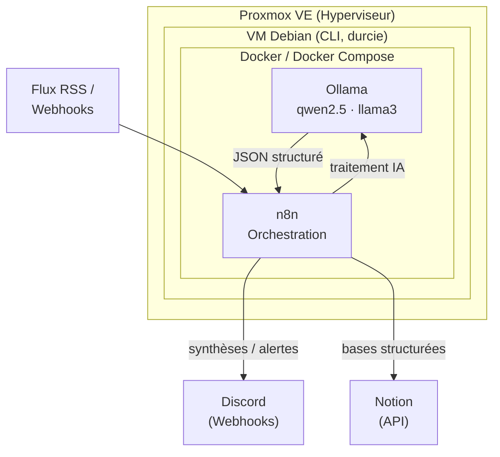

# 🖥️ Infrastructure Homelab & Agents IA Auto-hébergés

> Plateforme d'inférence IA et d'automatisation **100 % locale, souveraine et sans dépendance à des services cloud payants**.  
> Objectif : exécuter des agents intelligents autonomes (extraction, filtrage, classification, reporting) sur du matériel self-hosted, avec une confidentialité garantie.

 🧱 Socle : **Proxmox VE** + **Debian (CLI)** + **Docker**  
 🤖 IA locale : **Ollama** (qwen2.5, llama3) — zéro fuite de données vers des APIs tierces  
 🔗 Orchestration : **n8n** (RSS, Webhooks, Notion, Discord)  
 📦 Le déploiement conteneurisé est disponible dans ce dépôt : voir [`docker-compose.yml`](./docker-compose.yml)

---

## 📋 Sommaire

- [Architecture globale](#-architecture-globale)
- [Étapes de Déploiement &amp; Configuration](#%EF%B8%8F-étapes-de-déploiement--configuration)
- [Framework d'Agents IA &amp; Automatisation](#-framework-dagents-ia--automatisation)
- [Cas d'usage](#-cas-dusage)
- [Sécurité &amp; Bonnes pratiques](#-sécurité--bonnes-pratiques)
- [Auteur](#-auteur)

---

## 🏗️ Architecture globale

---

## ⚙️ Étapes de Déploiement &amp; Configuration

### 1. Socle Hyperviseur (Proxmox VE)

- Installation **bare-metal** de Proxmox VE.
- Configuration du réseau virtuel (bridges), de l'allocation des ressources hardware (RAM, vCPU, NVMe) et des **sauvegardes automatisées**.

### 2. Durcissement de la VM Debian (CLI)

Déploiement d'une VM Debian en mode **Serveur** (ligne de commande uniquement).

**Hardening & Sécurité :**

- Mises à jour du système (`apt update && apt upgrade`).
- Gestion stricte des utilisateurs et des règles **sudoers**.

### 3. Environnement Conteneurisé (Docker)

- Installation de **Docker Compose**.
- Configuration du groupe `docker` pour la gestion des privilèges.
- Création de **réseaux virtuels bridge isolés** pour séparer les conteneurs de production et de test.

➡️ L'ensemble des services est déployé via le fichier [`docker-compose.yml`](./docker-compose.yml) de ce dépôt.

---

## 🤖 Framework d'Agents IA &amp; Automatisation

Cette infrastructure est optimisée pour faire tourner des **agents intelligents autonomes** sans dépendre de services cloud payants.

### Inférence LLM locale — Ollama

- Exécution de modèles open-source performants : **qwen2.5**, **llama3**.
- Modèles compacts et rapides pour l'**extraction de données**, la **classification** et le **filtrage structuré (JSON)**.
- **Confidentialité garantie** : zéro fuite de données vers des APIs tierces.

### Orchestration de workflows — n8n

- Interconnexion entre les flux de données entrants (RSS, Webhooks), le traitement par l'IA locale (Ollama) et les destinations finales (Notion, Discord).

---

## 🎯 Cas d'usage

- [x] **Ingestion de données** : récupération automatique et fusion de flux RSS (ex. offres d'emploi IT, actualités cybersécurité).
- [x] **Traitement intelligent par IA** : filtrage, qualification des rôles et structuration sous format JSON via Ollama.
- [ ] **Centralisation des données** : ingestion automatique dans des bases structurées (Notion API).
- [ ] **Monitoring &amp; Reporting** : envoi de synthèses et d'alertes qualifiées via Discord Webhooks.

---

## 🔒 Sécurité &amp; Bonnes pratiques

| Principe                     | Mise en œuvre                                                          |
| ---------------------------- | ---------------------------------------------------------------------- |
| **Moindre privilège**        | Micro-segmentation des conteneurs sur des réseaux Docker dédiés        |
| **Souveraineté des données** | Traitement local des données sensibles grâce aux modèles auto-hébergés |

---

## 👤 Auteur

**Romain Gambart** —
